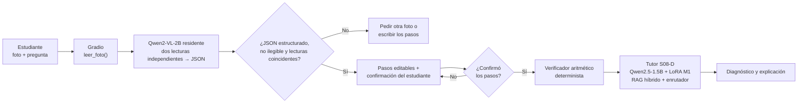

# Arquitectura real de M5

Este diagrama describe la configuración de producto
`TUTOR_CONFIG=revision_foto`. Es experimental: aún no se mide con las fotos
nuevas de M5. No debe confundirse con S08-D textual, que es la configuración
histórica medida (18/21) sin visión ni verificador.

## Decisiones que el diagrama hace explícitas

- La doble lectura no garantiza fidelidad: solo bloquea salidas inestables. Una
  foto puede inducir la misma invención dos veces; por eso el estudiante ve y
  corrige la transcripción antes de cualquier diagnóstico.
- El verificador aparece después de la confirmación. Revisa igualdades de los
  pasos aportados por el estudiante y entrega evidencia al tutor; no decide por
  sí solo el paso diagnosticado.
- `revision_foto` declara `herramientas=False`: no usa ReAct ni el registro
  general de herramientas de M3. Habilitarlos la convertiría en una nueva
  configuración experimental, no en la de este diagrama.
- No hay porcentaje de confianza ni umbral calibrado con fotos históricas. La
  ruta no incluye todavía un clasificador de legibilidad separado; esa es una
  limitación que debe medirse con las fotos nuevas de M5.

## Despliegue previsto

En Kaggle T4 se conservan cargados el VLM y el tutor, y se activa
`TUTOR_GRADIO_SHARE=1` solo para publicar el enlace temporal de la demo. Un
Hugging Face Space usa su URL propia y mantiene esa variable vacía.
